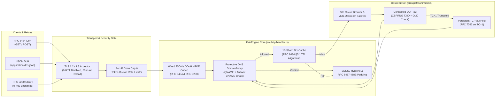

<div align="center">

# `daviante-doh`

**Ultra-Lightweight, Standards-Compliant DNS-over-HTTPS (RFC 8484), Oblivious DoH (RFC 9230), JSON DoH & Enterprise Protective DNS Library and Server**

[](https://github.com/daviante-org/daviante-doh/actions/workflows/ci.yml)
[](https://sonarcloud.io/summary/new_code?id=daviante-org_daviante-doh)
[](https://sonarcloud.io/summary/new_code?id=daviante-org_daviante-doh)
[](https://sonarcloud.io/summary/new_code?id=daviante-org_daviante-doh)
[)-orange.svg)](Cargo.toml)
[](LICENSE)

**[Architecture & UML](docs/ARCHITECTURE.md)** • **[Global Standards & Security](docs/STANDARDS_AND_SECURITY.md)** • **[Usage Guide & Examples](docs/USAGE_GUIDE.md)** • **[Deployment Guide](docs/DEPLOYMENT.md)** • **[Helm Chart](charts/daviante-doh/README.md)** • **[Contributing](CONTRIBUTING.md)**

Developed and maintained by **Daviante** (<https://daviante.org> | <https://github.com/daviante-org/daviante-doh>)

</div>

---

## Overview

**`daviante-doh`** is a clean-room, zero-telemetry Rust library (`daviante_doh`, [`src/lib.rs`](src/lib.rs)) and standalone server binary (`daviante-doh`, [`src/main.rs`](src/main.rs)) implementing:
- **DNS-over-HTTPS (`RFC 8484`)** — Wireformat `GET (?dns=<base64url>)`, `POST (application/dns-message)`, and `HEAD`.
- **Oblivious DNS-over-HTTPS (`RFC 9230` ODoH)** — HPKE (`X25519HkdfSha256` / `HkdfSha256` / `Aes128Gcm`) encrypted `POST (application/oblivious-dns-message)` with a lock-free 2-key rotation grace ring and key discovery at `/.well-known/odohconfigs`.
- **JSON DoH API (`RFC 3597` / Google & Cloudflare Spec)** — `GET /dns-query?name=...&type=...&do=...&cd=...` (`Accept: application/dns-json`).
- **EDNS0 Hygiene, 468-Byte Padding & Client Subnet (`RFC 6891`, `RFC 7830`, `RFC 7871`, `RFC 8467`)** — Strict OPT stripping for non-EDNS clients, 468-byte response block padding, and trusted-proxy CIDR verified ECS forwarding.
- **Protective DNS Policy & Extended DNS Errors (`RFC 8914`, `RFC 8482`)** — Fail-closed domain allowlist/blocklist (`nxdomain` + `EDE 15`, `refused` + `EDE 18`, `zero-ip` + `EDE 17`) with CNAME/DNAME answer-chain inspection and `QTYPE=ANY` refusal (`EDE 21`).
- **Cloud-Native Hardening** — Rootless `~10 MiB` Alpine 3.24 container (`USER 10001:0`, zero shell/curl runtime dependencies, built-in `--healthcheck`) and unified **Kubernetes & Red Hat OpenShift (`restricted-v2` SCC)** Helm chart ([`charts/daviante-doh/`](charts/daviante-doh/)).

---

## Documentation Suite

| Document | Contents |
| :--- | :--- |
| **[`docs/ARCHITECTURE.md`](docs/ARCHITECTURE.md)** | End-to-end **UML Component**, **UML Class**, **UML Sequence**, and **UML State** diagrams covering the DoH/JSON/ODoH pipeline, 16-shard `DnsCache`, 30s upstream circuit breaker, and module internals. |
| **[`docs/STANDARDS_AND_SECURITY.md`](docs/STANDARDS_AND_SECURITY.md)** | Complete rule-by-rule specification of all **20 IETF RFC, W3C, OWASP, and Kubernetes/OpenShift security standards** enforced by `daviante-doh`. |
| **[`docs/USAGE_GUIDE.md`](docs/USAGE_GUIDE.md)** | Practical CLI guide, client query examples (`curl`, `kdig`, Node.js HTTP/2, Python, ODoH HPKE), enterprise recipes (allow/blocklists, caching, rate limiting, ECS, Prometheus `/metrics`), and **Rust Library SDK** embedding examples. |
| **[`docs/DEPLOYMENT.md`](docs/DEPLOYMENT.md)** | Production deployment topologies and step-by-step guides for **Docker**, **Rootless Podman**, **Docker Compose**, **Kubernetes (MetalLB LoadBalancer + Ingress)**, **Red Hat OpenShift (`Route` + `restricted-v2` SCC)**, and cross-platform builds. |
| **[`charts/daviante-doh/README.md`](charts/daviante-doh/README.md)** | Dedicated Helm chart reference with complete `values.yaml` parameter table, schema validation, and Kubernetes/OpenShift installation recipes. |

---

## End-to-End Architecture & UML Request Flow



> See **[`docs/ARCHITECTURE.md`](docs/ARCHITECTURE.md)** for the full **UML Class Diagram**, **ODoH HPKE Sequence Diagram**, and **Circuit Breaker State Machine**.

---

## Global Standard Rules & Security Compliance

> [!IMPORTANT]
> **Standards-Mandated Rules ON by Default, Enterprise Controls Opt-In**: All IETF RFC protocol and security rules below are active out-of-the-box. Optional stateful features (in-memory caching, Prometheus `/metrics`, domain filtering, `ANY` blocking, rate limiting, ECS forwarding) default to **OFF** (`false` / `0`) and are 100% configurable via CLI flags or `DOH_*` environment variables.

| Category | Standard / Rule | Default Enforcement |
| :--- | :--- | :--- |
| **DoH Wire & HTTP** | **RFC 8484**, **RFC 1035** | `GET (?dns=)`, `POST`, `HEAD`; URI `<= 2048B` (`414`), Wire `17..=4096B` (`400`/`413`); strict `Accept`/`Content-Type` (`406`/`415`); rejects `QR=1`, `QDCOUNT!=1`, pointer loops, and `AXFR`/`IXFR`. |
| **HTTP Caching** | **RFC 9111**, **RFC 5861** | `min_ttl=0`; `TTL=0` emits `max-age=0, no-cache, no-store`; cache hits decrement wire TTL and emit `Age` without double-discounting; optional `stale-while-revalidate` & `stale-if-error`. |
| **Oblivious DoH** | **RFC 9230** | `POST`-only (`405` on `GET`), HPKE `X25519HkdfSha256`/`Aes128Gcm`, 2-key rotation ring (`[current, previous]`), 468-byte plaintext padding, `Cache-Control: no-store`. |
| **EDNS0 & Padding** | **RFC 6891**, **RFC 7830**, **RFC 8467** | Strips upstream `OPT` for non-EDNS clients; pads EDNS-padded / `DO=1` responses to exact **468-byte** block multiples (`Option Code 12`). |
| **Client Subnet (ECS)** | **RFC 7871**, **RFC 7239** | Evaluates `X-Forwarded-For` / `Forwarded` right-to-left **only** when TCP peer matches `--trusted-proxies`; never leaks private/loopback IPs; truncates to `/24` (IPv4) and `/56` (IPv6). |
| **Extended DNS Errors** | **RFC 8914**, **RFC 8482** | Synthesizes `EDE 15 (Blocked)`, `EDE 17 (Filtered)`, `EDE 18 (Prohibited)`, `EDE 21 (Not Supported)` on `QTYPE=ANY`, `EDE 22 (No Reachable Authority)`, and `EDE 23 (Network Error)`. |
| **Upstream Resilience** | **RFC 5452**, **RFC 7766** | CSPRNG TXID randomization, bounded UDP loop discarding spoofed TXID/Question datagrams, `0x20` case restoration, 30s circuit breaker, and persistent TCP `:53` connection pool on `TC=1`. |
| **Privacy & OWASP** | **RFC 8932**, **OWASP** | Zero-PII logging by default (`--log-queries=false`, `--log-client-ip=false`); injects `nosniff`, `X-Frame-Options: DENY`, `Referrer-Policy: no-referrer`, `CORP: cross-origin`, and `HSTS`. |

> See **[`docs/STANDARDS_AND_SECURITY.md`](docs/STANDARDS_AND_SECURITY.md)** for the complete rule-by-rule specification.

---

## Configuration Reference (100% Configurable via Env or CLI)

| Environment Variable | CLI Flag | Default | Description |
| :--- | :--- | :--- | :--- |
| `DOH_LISTEN_ADDRESS` | `-l, --listen-address` | `0.0.0.0:3000` | Primary socket address to listen on (`IP:port`) |
| `DOH_ADMIN_LISTEN_ADDRESS` | `--admin-listen-address` | *(disabled)* | Optional isolated listener for `/metrics`, `/livez`, `/readyz`, `/healthz` |
| `DOH_SERVER_ADDRESS` | `-u, --server-address` | `9.9.9.9:53` | Upstream UDP/TCP DNS resolver(s), comma-separated for failover |
| `DOH_LOCAL_BIND_ADDRESS` | `-b, --local-bind-address` | *(auto)* | Local outbound bind address (`0.0.0.0:0` or `[::]:0`) |
| `DOH_HOSTNAME` | `-H, --hostname` | *(optional)* | Public hostname (generates `sdns://` DoH & ODoH DNS stamps on startup) |
| `DOH_PUBLIC_ADDRESS` | `-g, --public-address` | *(optional)* | Comma/space-separated list of public IPs for DNS stamps |
| `DOH_PUBLIC_PORT` | `-j, --public-port` | *(optional)* | External public port if not `443` |
| `DOH_PATH` | `-p, --path` | `/dns-query` | DoH endpoint URI path |
| `DOH_ODOH_CONFIGS_PATH` | `--odoh-configs-path` | `/.well-known/odohconfigs` | RFC 9230 ODoH key configuration URI path |
| `DOH_HEALTH_PATH` | `--health-path` | `/healthz` | Liveness / readiness probe URI path (`/livez` & `/readyz` always active) |
| `DOH_ENABLE_METRICS` | `--enable-metrics` | `false` | Set `true`/`1`/`yes`/`on` to enable Prometheus `/metrics` endpoint |
| `DOH_METRICS_PATH` | `--metrics-path` | `/metrics` | Prometheus / OpenMetrics URI path |
| `DOH_MAX_CLIENTS` | `-c, --max-clients` | `512` | Max simultaneous client connections |
| `DOH_MAX_CONCURRENT` | `-C, --max-concurrent` | `16` | Max concurrent HTTP/2 streams per client |
| `DOH_MAX_CONNS_PER_IP` | `--max-conns-per-ip` | `0` | Max concurrent TCP connections per peer IP (`0` = disabled) |
| `DOH_TIMEOUT` | `-t, --timeout` | `10` | Per-request timeout in seconds (`1`–`3600`) |
| `DOH_SHUTDOWN_GRACE_PERIOD` | `--shutdown-grace-period` | `15` | Graceful `SIGTERM` / `Ctrl-C` connection drain timeout in seconds |
| `DOH_MIN_TTL` | `-T, --min-ttl` | `0` | Minimum DNS cache TTL floor in seconds (`0` per RFC 8484 §5.1) |
| `DOH_MAX_TTL` | `-X, --max-ttl` | `604800` | Maximum caching TTL in seconds |
| `DOH_ERR_TTL` | `-E, --err-ttl` | `2` | Error response TTL in seconds |
| `DOH_STALE_IF_ERROR_SECS` | `--stale-if-error-secs` | `0` | Optional RFC 5861 `stale-if-error` directive (`0` = disabled) |
| `DOH_STALE_WHILE_REVALIDATE_SECS` | `--stale-while-revalidate-secs` | `0` | Optional RFC 5861 `stale-while-revalidate` directive (`0` = disabled) |
| `DOH_CACHE_SIZE` | `--cache-size` | `0` | In-memory 16-shard DNS cache capacity (`0` = disabled by default) |
| `DOH_DISABLE_KEEPALIVE` | `-K, --disable-keepalive` | `false` | Disable HTTP keepalive |
| `DOH_DISABLE_POST` | `-P, --disable-post` | `false` | Disable standard DoH `POST` queries |
| `DOH_ALLOW_ODOH_POST` | `-O, --allow-odoh-post` | `false` | Allow ODoH `POST` when `--disable-post` is set |
| `DOH_DISABLE_ANY` | `--disable-any` | `false` | Refuse `QTYPE=ANY` queries per RFC 8482 (`EDE 21`) |
| `DOH_ENABLE_ECS` | `--enable-ecs` | `false` | Enable RFC 7871 EDNS Client Subnet |
| `DOH_TRUSTED_PROXIES` | `--trusted-proxies` | *(empty)* | Comma-separated trusted proxy CIDRs for `X-Forwarded-For` / `Forwarded` |
| `DOH_ECS_PREFIX_V4` | `--ecs-prefix-v4` | `24` | IPv4 prefix length for ECS (`0`–`32`) |
| `DOH_ECS_PREFIX_V6` | `--ecs-prefix-v6` | `56` | IPv6 prefix length for ECS (`0`–`128`) |
| `DOH_ODOH_ROTATION_SECS` | `--odoh-rotation-secs` | `86400` | ODoH HPKE key rotation interval in seconds (`60`–`604800`) |
| `DOH_ALLOWLIST_FILE` | `--allowlist-file` | *(optional)* | Path to Protective DNS domain allowlist file (fails closed if missing) |
| `DOH_BLOCKLIST_FILE` | `--blocklist-file` | *(optional)* | Path to Protective DNS domain blocklist file (fails closed if missing) |
| `DOH_BLOCK_ACTION` | `--block-action` | `nxdomain` | Block action: `nxdomain` (`EDE 15`), `refused` (`EDE 18`), or `zero-ip` (`EDE 17`) |
| `DOH_RATE_LIMIT_RPS` | `--rate-limit-rps` | `0` | Per-IP rate limit in requests/sec (`0` = disabled by default) |
| `DOH_RATE_LIMIT_BURST` | `--rate-limit-burst` | `20` | Per-IP token-bucket burst capacity |
| `DOH_RATE_LIMIT_V6_PREFIX` | `--rate-limit-v6-prefix` | `64` | IPv6 prefix length aggregated into a single rate-limit bucket |
| `DOH_CORS_ALLOW_ORIGIN` | `--cors-allow-origin` | `*` | Value for `Access-Control-Allow-Origin` header |
| `DOH_LOG_QUERIES` | `--log-queries` | `false` | Emit structured JSON query audit logs |
| `DOH_LOG_CLIENT_IP` | `--log-client-ip` | `false` | Client IP audit mode: `false`, `truncated` (`/24` & `/56`), or `full` |
| `DOH_LOG_FORMAT` | `--log-format` | `json` | Log format: `json` or `text` |
| `DOH_LOG_LEVEL` | `--log-level` | `info` | Log level: `error`, `warn`, `info`, `debug`, `trace` |
| `DOH_TLS_CERT_PATH` | `-i, --tls-cert-path` | *(optional)* | Path to PEM certificate chain (enables built-in HTTPS) |
| `DOH_TLS_CERT_KEY_PATH` | `-I, --tls-cert-key-path` | *(optional)* | Path to PEM/PKCS#8 private key |
| `DOH_TLS_MIN_VERSION` | `--tls-min-version` | `1.2` | Minimum TLS protocol version (`1.2` or `1.3`; 0-RTT always disabled) |

---

## Quick Start & Examples

### 1. Podman / Docker (Hardened Rootless Runtime)
```bash
podman run -d --name daviante-doh \
  --read-only --cap-drop=ALL --security-opt no-new-privileges:true \
  -p 3000:3000 \
  -e DOH_HOSTNAME="doh.example.com" \
  -e DOH_SERVER_ADDRESS="9.9.9.9:53,1.1.1.1:53" \
  -e DOH_CACHE_SIZE="10000" \
  -e DOH_ENABLE_METRICS="true" \
  ghcr.io/daviante-org/daviante-doh:latest
```

### 2. Kubernetes & Red Hat OpenShift (Unified Helm Chart)
```bash
# Standard Kubernetes (LoadBalancer + Ingress + 10k Cache)
helm upgrade --install daviante-doh ./charts/daviante-doh \
  --namespace daviante-doh --create-namespace \
  --set service.type=LoadBalancer \
  --set config.serverAddress="9.9.9.9:53\,1.1.1.1:53" \
  --set config.cacheSize=10000

# Red Hat OpenShift (restricted-v2 SCC compatible out-of-the-box + OpenShift Route)
helm upgrade --install daviante-doh ./charts/daviante-doh \
  --namespace daviante-doh \
  --set route.enabled=true \
  --set route.host="doh.apps.ocp.example.com"
```

### 3. Client Query Verification (`curl`)
```bash
# RFC 8484 Wireformat GET (example.com IN A)
curl -fsS -H "Accept: application/dns-message" \
  "http://127.0.0.1:3000/dns-query?dns=AAABAAABAAAAAAAAB2V4YW1wbGUDY29tAAABAAE" | xxd

# JSON DoH API (example.com IN A with DNSSEC DO=1)
curl -fsS -H "Accept: application/dns-json" \
  "http://127.0.0.1:3000/dns-query?name=example.com&type=A&do=1"

# Fetch RFC 9230 Oblivious DoH HPKE Public Key Configs
curl -fsS "http://127.0.0.1:3000/.well-known/odohconfigs" | xxd

# Health & OpenMetrics Endpoints
curl -fsS "http://127.0.0.1:3000/healthz"
curl -fsS "http://127.0.0.1:3000/metrics"
```

### 4. Embedding as a Pure Rust Library (`daviante_doh`)
```toml
[dependencies]
daviante-doh = { version = "0.1.0", default-features = false, features = ["tls"] }
```

```rust
use std::time::Duration;
use tokio::net::TcpListener;
use daviante_doh::{serve_with_shutdown, DohConfig, DohEngine, OdohKeyManager};

#[tokio::main]
async fn main() -> Result<(), Box<dyn std::error::Error>> {
    let listener = TcpListener::bind("127.0.0.1:3000").await?;
    let config = DohConfig {
        listen_address: listener.local_addr()?,
        cache_size: 4096,
        ..DohConfig::default()
    };
    let odoh_keys = OdohKeyManager::spawn(tokio::runtime::Handle::current(), Duration::from_secs(86400))?;
    let engine = DohEngine::new(config, odoh_keys)?;
    serve_with_shutdown(engine, listener, async { let _ = tokio::signal::ctrl_c().await; }).await?;
    Ok(())
}
```

> See **[`docs/USAGE_GUIDE.md`](docs/USAGE_GUIDE.md)** and **[`docs/DEPLOYMENT.md`](docs/DEPLOYMENT.md)** for full recipes.

---

## Multi-Environment Black-Box API & Protocol Verification Matrix

Every commit is verified by a **219-case live Black-Box API & Protocol Matrix** ([`scripts/e2e/live-api-suite.mjs`](scripts/e2e/live-api-suite.mjs) and [`scripts/e2e/run-k8s-openshift-blackbox.sh`](scripts/e2e/run-k8s-openshift-blackbox.sh)) across three production-grade environments:

| Platform Environment | Replicas | Load Balancer & Routing Topology | Security Context | Pass Rate | Latency (`mean` / `p50` / `p95`) | Cache Hit Speedup | 500-Request Flood Telemetry | Verdict |
| :--- | :---: | :--- | :--- | :---: | :---: | :---: | :---: | :---: |
| **Standalone Container (Podman/Docker)** | 1 | Direct Container Port-Map (`127.0.0.1:8443 -> 8443/tcp`) | Non-Root (`UID 10001:0`, `cap-drop=ALL`, `read-only`) | **73/73** (100%) | `5.33 ms` / `1.57 ms` / `21.07 ms` | **13.2x** | `151 OK / 349 429 (0 drops)` | **PASS** |
| **Kubernetes (`kind` + MetalLB LB + Ingress)** | 2 | MetalLB L2 LoadBalancer VIP + HAProxy L7 Ingress -> 2x `daviante-doh` Pods | Kubernetes `restricted` PSA (`UID 10001:0`, `readOnlyRootFilesystem`, `RuntimeDefault`) | **73/73** (100%) | `10.21 ms` / `2.67 ms` / `28.67 ms` | **13.2x** | `326 OK / 174 429 (0 drops)` | **PASS** |
| **Red Hat OpenShift (`Route` CRD + HAProxy Router)** | 2 | OpenShift HAProxy Router (`route.openshift.io/v1` `reencrypt` HTTP/2) -> 2x `daviante-doh` Pods | OpenShift `restricted-v2` SCC (Arbitrary `UID 20001:0`, `readOnlyRootFilesystem`, `cap-drop=ALL`) | **73/73** (100%) | `9.55 ms` / `2.53 ms` / `25.08 ms` | **9.6x** | `333 OK / 167 429 (0 drops)` | **PASS** |

Full machine-readable and Markdown evidence reports are published in [`test-evidence/multi-env-matrix.md`](test-evidence/multi-env-matrix.md) and [`test-evidence/multi-env-metrics.json`](test-evidence/multi-env-metrics.json).

---

## License

MIT License — Copyright (c) 2026 **Daviante** (<https://daviante.org>). See [`LICENSE`](LICENSE) for details.
