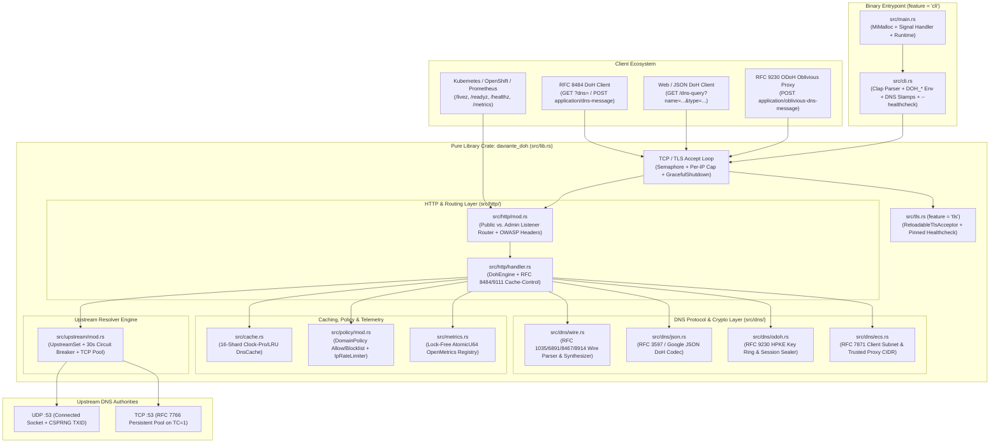
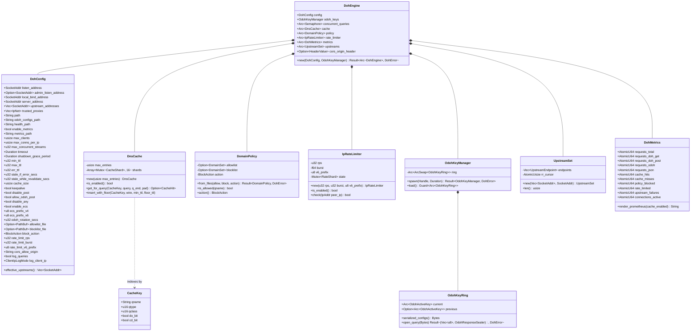
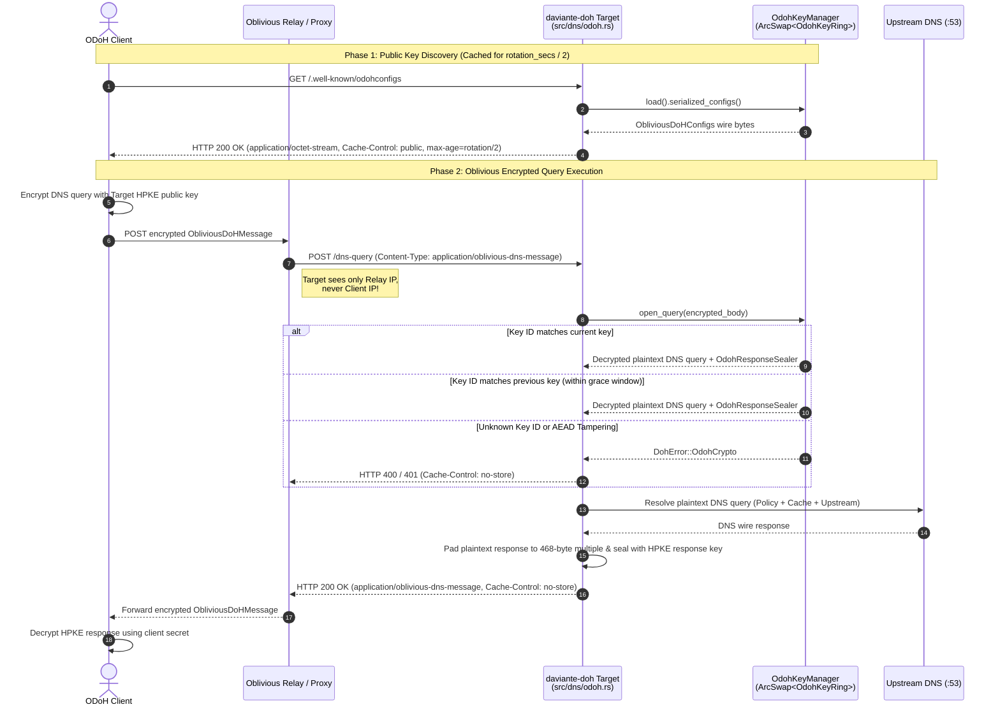

# `daviante-doh` Architecture & UML Design Reference

<div align="center">

**[Project Home](../README.md)** • **[Architecture & UML](ARCHITECTURE.md)** • **[Global Standards & Security](STANDARDS_AND_SECURITY.md)** • **[Usage Guide & Examples](USAGE_GUIDE.md)** • **[Deployment Guide](DEPLOYMENT.md)** • **[Helm Chart](../charts/daviante-doh/README.md)**

</div>

---

## Table of Contents

1. [Architectural Principles](#1-architectural-principles)
2. [UML Component & Crate Boundary Diagram](#2-uml-component--crate-boundary-diagram)
3. [UML Class Diagram (Core Domain Model)](#3-uml-class-diagram-core-domain-model)
4. [UML Sequence Diagram: Standard DoH & JSON DoH Pipeline](#4-uml-sequence-diagram-standard-doh--json-doh-pipeline)
5. [UML Sequence Diagram: Oblivious DoH (RFC 9230) HPKE Lifecycle](#5-uml-sequence-diagram-oblivious-doh-rfc-9230-hpke-lifecycle)
6. [UML Sequence Diagram: Upstream Forgery Resilience & TCP Fallback](#6-uml-sequence-diagram-upstream-forgery-resilience--tcp-fallback)
7. [UML State Diagrams: Circuit Breaker & Key Rotation](#7-uml-state-diagrams-circuit-breaker--key-rotation)
8. [Module-by-Module Engineering Breakdown](#8-module-by-module-engineering-breakdown)

---

## 1. Architectural Principles

`daviante-doh` is engineered around five non-negotiable architectural invariants:

> [!IMPORTANT]
> **Compile-Time Memory & Panic Safety**: Both the library crate (`daviante_doh`) and binary (`daviante-doh`) enforce `#![forbid(unsafe_code)]` and `#![deny(clippy::unwrap_used)]` across all production modules. Malformed network packets, truncated DNS headers, or upstream failures can never trigger an unhandled panic or out-of-bounds memory access.

1. **Strict Crate Boundary (`daviante_doh` Library vs. `daviante-doh` CLI Binary)**:
   - Compiling with `--no-default-features` (or `--no-default-features --features tls`) produces a pure embeddable Rust library free of CLI (`clap`), allocator (`mimalloc`), or DNS stamp (`dnsstamps`) dependencies.
2. **Lock-Free Hot Path**:
   - The HTTP/1.1 & HTTP/2 request router, ODoH HPKE key ring (`ArcSwap<OdohKeyRing>`), TLS acceptor (`ArcSwap<TlsAcceptor>`), and OpenMetrics counters (`AtomicU64`) operate without global mutexes on the packet-forwarding path.
   - The in-memory DNS cache (`DnsCache`) partitions entries across **16 independent shards** (`SHARD_COUNT = 16`) using FNV-1a hashing to eliminate lock contention under high concurrency.
3. **Standards-Mandated Rules Always ON, Stateful Enterprise Controls Opt-In**:
   - All IETF RFC protocol rules (RFC 8484, RFC 9230, RFC 7871, RFC 8467, RFC 8914, RFC 8932, RFC 5452, RFC 7766, RFC 9111) and OWASP security headers are active by default.
   - Stateful or environment-specific features (in-memory caching, Prometheus `/metrics`, isolated admin listener, domain allowlist/blocklist, `QTYPE=ANY` refusal, rate limiting, ECS injection) default to **OFF** (`false` / `0`) and are 100% configurable via CLI flags and `DOH_*` environment variables.

---

## 2. UML Component & Crate Boundary Diagram



---

## 3. UML Class Diagram (Core Domain Model)



---

## 4. UML Sequence Diagram: Standard DoH & JSON DoH Pipeline

The following sequence diagram traces a client DNS query from TCP/TLS connection acceptance through policy enforcement, sharded cache lookup, upstream resolution, CNAME chain verification, and HTTP response synthesis:

```mermaid
sequenceDiagram
    autonumber
    actor Client as DoH / JSON Client
    participant Listener as TCP/TLS Listener<br/>(src/lib.rs)
    participant Router as HTTP Router<br/>(src/http/mod.rs)
    participant Engine as DohEngine<br/>(src/http/handler.rs)
    participant Limiter as IpRateLimiter<br/>(src/policy/mod.rs)
    participant Policy as DomainPolicy<br/>(src/policy/mod.rs)
    participant Cache as DnsCache (16-Shard)<br/>(src/cache.rs)
    participant Upstream as UpstreamSet<br/>(src/upstream/mod.rs)
    participant DNS as Upstream DNS (:53)

    Client->>Listener: TLS 1.3 / HTTP/2 Stream (GET or POST /dns-query)
    Listener->>Listener: Acquire max_clients Semaphore & Per-IP Connection Slot
    Listener->>Router: Service::call(Request<Incoming>)
    Router->>Engine: handle_doh_request(req, engine, peer_ip)

    Engine->>Engine: Resolve real client IP (verify peer_ip in trusted_proxies before reading XFF/Forwarded)
    Engine->>Limiter: check(client_ip) (IPv4 /32 or IPv6 /64 token bucket)
    alt Rate Limit Exceeded
        Limiter-->>Engine: false
        Engine-->>Client: HTTP 429 Too Many Requests (Retry-After: 1, Cache-Control: no-store)
    end

    Engine->>Engine: Negotiate RequestFlavor (StandardDoh / JsonDoh / Odoh) & validate wire query (RFC 8484)
    alt Invalid Wire Query / Unsupported Media Type / URI > 2048B
        Engine-->>Client: HTTP 400 / 405 / 406 / 413 / 414 / 415 (Cache-Control: no-store)
    end

    alt QTYPE == ANY (255) and disable_any == true
        Engine-->>Client: HTTP 200 OK (RCODE=NOTIMP 4 + RFC 8914 EDE 21 Not Supported)
    end

    Engine->>Policy: is_allowed(qname)
    alt Domain Blocked by Allowlist or Blocklist
        Policy-->>Engine: false
        Engine-->>Client: HTTP 200 OK (Synthesized NXDOMAIN+EDE 15 / REFUSED+EDE 18 / 0.0.0.0+EDE 17)
    end

    alt Cache Lookup Eligible (no client ECS, cache_size > 0)
        Engine->>Cache: get_for_query(CacheKey, client_query, pad_468)
        alt Cache Hit
            Cache-->>Engine: CacheHit { wire_bytes (TTL decremented, TXID & 0x20 restored), remaining_ttl, age }
            Engine-->>Client: HTTP 200 OK (Cache-Control: public, max-age=remaining_ttl, Age: age)
        end
    end

    Engine->>Engine: Optional RFC 7871 ECS synthesis (/24 IPv4, /56 IPv6; never leaks RFC 1918/loopback)
    Engine->>Upstream: resolve_upstream_with_set(wire_query, deadline)
    Upstream->>DNS: UDP datagram (randomized TXID) or TCP fallback on TC=1
    DNS-->>Upstream: Raw DNS wire response
    Upstream-->>Engine: Verified DNS wire response (original TXID & 0x20 QNAME restored)

    Engine->>Policy: Inspect Answer CNAME / DNAME targets against DomainPolicy
    alt CNAME Target Blocked
        Policy-->>Engine: false
        Engine-->>Client: HTTP 200 OK (Synthesized Blocked Response + EDE)
    end

    alt Cacheable Response (ECS scope == 0)
        Engine->>Cache: insert_with_floor(CacheKey, wire_response, effective_ttl, min_ttl)
    end

    Engine->>Engine: Finalize client EDNS0 OPT & RFC 8467 468-byte block padding
    Engine-->>Client: HTTP 200 OK (application/dns-message or application/dns-json + OWASP headers)
```

---

## 5. UML Sequence Diagram: Oblivious DoH (RFC 9230) HPKE Lifecycle

`daviante-doh` implements RFC 9230 Oblivious DoH using HPKE (`KEM: X25519HkdfSha256`, `KDF: HkdfSha256`, `AEAD: Aes128Gcm`) with a lock-free 2-key rotation grace ring (`[current, previous]`) so in-flight client queries never fail during key rotation:



---

## 6. UML Sequence Diagram: Upstream Forgery Resilience & TCP Fallback

Per **RFC 5452 §9.1** and **RFC 7766 §6.2.1**, `src/upstream/mod.rs` protects against off-path and in-window UDP spoofing while maintaining a persistent TCP connection pool for truncated (`TC=1`) responses:

```mermaid
sequenceDiagram
    autonumber
    participant Handler as DohEngine
    participant Resolver as UpstreamSet<br/>(src/upstream/mod.rs)
    participant UdpSock as Ephemeral UDP Socket
    participant TcpPool as Persistent TCP Pool<br/>(RFC 7766)
    participant Auth as Upstream DNS (:53)

    Handler->>Resolver: resolve_single_upstream(query, endpoint, deadline)
    Resolver->>Resolver: Save client TXID & 0x20 Question bytes; generate CSPRNG 16-bit TXID
    Resolver->>UdpSock: bind(local_bind_address) + connect(endpoint)
    UdpSock->>Auth: send(randomized_query)

    loop Bounded Read Loop (until deadline)
        Auth-->>UdpSock: recv(udp_packet)
        alt Packet < 12B or TXID != randomized_txid
            UdpSock->>UdpSock: Log WARN & ignore spoofed datagram (continue waiting)
        else QR != 1 or Question != client_question (case-insensitive)
            UdpSock->>UdpSock: Log WARN & ignore mismatched Question (continue waiting)
        else Valid Matching Response
            UdpSock-->>Resolver: Verified UDP response
        end
    end

    alt UDP Response has TC == 1 (Truncated)
        Resolver->>TcpPool: Pop pooled TcpStream (or connect new TCP :53)
        TcpPool->>Auth: Write 2-byte length prefix + query
        Auth-->>TcpPool: Read 2-byte length prefix + full DNS response (up to 65,535B)
        TcpPool->>TcpPool: Return healthy TcpStream to endpoint idle pool (max 8)
        TcpPool-->>Resolver: Full un-truncated DNS wire response
    end

    Resolver->>Resolver: Restore original client TXID & exact 0x20 Question casing
    Resolver-->>Handler: Final verified DNS wire response
```

---

## 7. UML State Diagrams: Circuit Breaker & Key Rotation

### 7.1 Per-Upstream 30-Second Circuit Breaker (`src/upstream/mod.rs`)

When multiple upstreams are configured (`--server-address 9.9.9.9:53,1.1.1.1:53`), each upstream maintains an atomic UNIX timestamp cooldown (`CIRCUIT_BREAKER_COOLDOWN = 30s`):

```mermaid
stateDiagram-v2
    [*] --> Closed : Startup (cooldown_until = 0)

    Closed --> Closed : UDP/TCP Query Succeeds
    Closed --> Open : Timeout or Socket Error<br/>(sets cooldown_until = now + 30s,<br/>increments daviante_doh_upstream_failures_total,<br/>fails over immediately to next upstream)

    Open --> Open : now < cooldown_until<br/>(Skipped in 0ms; routes to healthy secondary)<br/>Fallback if ALL upstreams are Open
    Open --> HalfOpen : now >= cooldown_until<br/>(Cooldown expired)

    HalfOpen --> Closed : Probe Query Succeeds<br/>(reset cooldown_until = 0)
    HalfOpen --> Open : Probe Query Fails<br/>(sets cooldown_until = now + 30s)
```



### 7.2 ODoH Key Rotation & TLS Hot-Reload State Machine

```mermaid
stateDiagram-v2
    state "OdohKeyManager (src/dns/odoh.rs)" as ODOH {
        [*] --> SingleKey : Startup (generate Key K1)
        SingleKey --> DualKeyGraceRing : Tick (every odoh_rotation_secs)<br/>current = K2, previous = Some(K1)
        DualKeyGraceRing --> DualKeyGraceRing : Tick (every odoh_rotation_secs)<br/>current = K(n), previous = Some(K(n-1))
    }

    state "ReloadableTlsAcceptor (src/tls.rs)" as TLS {
        [*] --> ActiveCert : Startup (load PEM cert & key, mtime_0)
        ActiveCert --> ActiveCert : Poll every 60s (mtime unchanged)
        ActiveCert --> HotSwapped : Poll detects new mtime & valid PEM<br/>(ArcSwap::store new TlsAcceptor, zero dropped connections)
        ActiveCert --> ActiveCert : Poll detects invalid/partial PEM<br/>(Log WARN & retain last-known-good TlsAcceptor)
        HotSwapped --> ActiveCert : Continue monitoring
    }
```

---

## 8. Module-by-Module Engineering Breakdown

| Source File | Primary Responsibility | Key Types & Functions |
| :--- | :--- | :--- |
| [`src/lib.rs`](../src/lib.rs) | Library root, configuration model, TCP/TLS accept loop, per-IP connection tracking, and graceful `SIGTERM` connection draining. | `DohConfig`, `ClientIpLogMode`, `IpConnTracker`, `serve`, `serve_with_shutdown` |
| [`src/main.rs`](../src/main.rs) | Binary entrypoint (`feature = "cli"`), `MiMalloc` global allocator registration, OS signal handling (`SIGTERM` / `Ctrl-C`). | `main` |
| [`src/cli.rs`](../src/cli.rs) | CLI flag & `DOH_*` environment parser, boolean/empty-env sanitizer, `sdns://` DNS Stamp generator, `--print-config`, and native `--healthcheck` client, plus zero-dependency JSON/text structured `tracing` subscriber. | `CliArgs`, `run_from_env`, `build_config_from_args`, `execute_healthcheck` |
| [`src/http/mod.rs`](../src/http/mod.rs) | HTTP request router separating public DoH/ODoH traffic from optional isolated `--admin-listen-address` traffic, plus OWASP security header injection. | `route_public_request`, `route_admin_request`, `finalize_common_headers` |
| [`src/http/handler.rs`](../src/http/handler.rs) | Core `DohEngine` request pipeline: content negotiation, URI/body size limits, rate-limit check, policy check, cache lookup/insertion, upstream dispatch, and RFC 8484/9111 `Cache-Control` synthesis. | `DohEngine`, `RequestFlavor`, `handle_doh_request`, `build_cache_control_header` |
| [`src/dns/wire.rs`](../src/dns/wire.rs) | Zero-unsafe DNS wire-format parser, compression pointer loop detector, EDNS0 `OPT` manipulator, RFC 8467 468-byte padding calculator, RFC 8914 Extended DNS Error (`EDE`) attachment, and synthetic policy responses. | `ParsedQueryMeta`, `validate_and_parse_query`, `finalize_wire_response_for_client`, `attach_ede_to_response`, `build_policy_response` |
| [`src/dns/json.rs`](../src/dns/json.rs) | Google / Cloudflare `application/dns-json` query builder and RFC 3597 wire-to-JSON response serializer (including `Status`, `Question`, `Answer`, `Authority`, `Comment`, and `EDE`). | `JsonDnsQueryParams`, `build_wire_query_from_json_params`, `wire_response_to_json` |
| [`src/dns/odoh.rs`](../src/dns/odoh.rs) | RFC 9230 Oblivious DoH HPKE key generation, lock-free 2-key rotation grace ring (`[current, previous]`), query opener, and 468-byte padded response sealer. | `OdohKeyManager`, `OdohKeyRing`, `OdohActiveKey`, `OdohResponseSealer` |
| [`src/dns/ecs.rs`](../src/dns/ecs.rs) | RFC 7871 EDNS Client Subnet option parser/synthesizer and right-to-left `X-Forwarded-For` / `Forwarded` trusted-proxy CIDR verifier. | `IpNet`, `extract_client_ip`, `append_ecs_to_query`, `extract_ecs_scope_from_response` |
| [`src/cache.rs`](../src/cache.rs) | 16-shard in-memory DNS wire response cache with bounded entry size (`4096B`), dynamic TTL decrementation, TXID/Question rewriting, and per-client EDNS padding normalization. | `DnsCache`, `CacheKey`, `CacheHit`, `MAX_CACHE_ENTRY_BYTES` |
| [`src/policy/mod.rs`](../src/policy/mod.rs) | Fail-closed domain allowlist/blocklist engine (exact + subdomain wildcard matching) and per-IP token-bucket rate limiter with IPv6 `/64` prefix aggregation. | `DomainPolicy`, `BlockAction`, `IpRateLimiter` |
| [`src/upstream/mod.rs`](../src/upstream/mod.rs) | Multi-upstream UDP/TCP DNS resolver with CSPRNG TXID randomization, spoofed datagram filtering, 30-second per-upstream circuit breaker, and persistent RFC 7766 TCP connection pooling. | `UpstreamSet`, `resolve_upstream_with_set`, `CIRCUIT_BREAKER_COOLDOWN` |
| [`src/metrics.rs`](../src/metrics.rs) | Lock-free `AtomicU64` Prometheus / OpenMetrics telemetry registry tracking request flavors, latency histograms (`le="0.001"`..`le="+Inf"`), DNS RCODEs, cache hits/misses, policy blocks, and active connections. | `DohMetrics` |
| [`src/tls.rs`](../src/tls.rs) | `tokio-rustls` TLS 1.2/1.3 server configuration (`0-RTT` disabled, ALPN `h2` + `http/1.1`), background 60s certificate hot-reload watcher, and leaf-pinned TLS healthcheck connector. | `TlsMinVersion`, `ReloadableTlsAcceptor`, `build_pinned_healthcheck_connector` |
| [`src/error.rs`](../src/error.rs) | Unified strongly-typed error hierarchy mapped deterministically to HTTP status codes (`400`, `401`, `405`, `406`, `413`, `414`, `415`, `502`, `504`). | `DohError` |
