# `daviante-doh` Production Deployment Guide (Docker, Podman, Kubernetes & OpenShift)

<div align="center">

**[Project Home](../README.md)** • **[Architecture & UML](ARCHITECTURE.md)** • **[Global Standards & Security](STANDARDS_AND_SECURITY.md)** • **[Usage Guide & Examples](USAGE_GUIDE.md)** • **[OpenAPI 3.1 Spec](openapi.yaml)** • **[Deployment Guide](DEPLOYMENT.md)** • **[Helm Chart](../charts/daviante-doh/README.md)**

</div>

---

## Table of Contents

1. [Deployment Topologies Overview](#1-deployment-topologies-overview)
2. [Standalone Container (Docker & Rootless Podman)](#2-standalone-container-docker--rootless-podman)
3. [Docker Compose / Podman Compose](#3-docker-compose--podman-compose)
4. [Kubernetes Production Deployment (MetalLB / Cloud LoadBalancer & Ingress)](#4-kubernetes-production-deployment-metallb--cloud-loadbalancer--ingress)
5. [Red Hat OpenShift Deployment (`restricted-v2` SCC & OpenShift Route)](#5-red-hat-openshift-deployment-restricted-v2-scc--openshift-route)
6. [Cross-Platform Standalone Binary Builds](#6-cross-platform-standalone-binary-builds)

---

## 1. Deployment Topologies Overview

```mermaid
flowchart TB
    subgraph TopologyA["Topology A: Standalone Container / Compose"]
        ClientA["DoH / ODoH / JSON Client"] -->|"HTTPS :443 / :8443 (HTTP/2)"| ContA["daviante-doh Container<br/>(UID 10001:0, read-only rootfs, cap-drop=ALL)"]
    end

    subgraph TopologyB["Topology B: Kubernetes (MetalLB / Cloud LB + L7 Ingress)"]
        ClientB["DoH / ODoH / JSON Client"] -->|"External VIP :443"| K8sLB["Service (type=LoadBalancer)<br/>or L7 Ingress Controller"]
        K8sLB -->|"HTTP/2 TLS Pod Mesh"| K8sPod1["daviante-doh Pod 1<br/>(UID 10001:0, PSA restricted)"]
        K8sLB -->|"HTTP/2 TLS Pod Mesh"| K8sPod2["daviante-doh Pod 2<br/>(UID 10001:0, PSA restricted)"]
        PromB["Prometheus Operator"] -->|"Scrape :9090/metrics"| K8sPod1
        PromB -->|"Scrape :9090/metrics"| K8sPod2
    end

    subgraph TopologyC["Topology C: Red Hat OpenShift (HAProxy Router + restricted-v2 SCC)"]
        ClientC["DoH / ODoH / JSON Client"] -->|"HTTPS :443 (SNI Route)"| OcpRouter["OpenShift HAProxy Router<br/>(route.openshift.io/v1 reencrypt / edge)"]
        OcpRouter -->|"Re-encrypted HTTP/2 TLS"| OcpPod1["daviante-doh Pod 1<br/>(Arbitrary UID 1000680001:0)"]
        OcpRouter -->|"Re-encrypted HTTP/2 TLS"| OcpPod2["daviante-doh Pod 2<br/>(Arbitrary UID 1000680002:0)"]
    end
```



---

## 2. Standalone Container (Docker & Rootless Podman)

### 2.1 Pull & Run with Zero-Privilege Hardening
```bash
podman run -d --name daviante-doh \
  --read-only \
  --cap-drop=ALL \
  --security-opt no-new-privileges:true \
  -p 3000:3000 \
  -e DOH_SERVER_ADDRESS="9.9.9.9:53,1.1.1.1:53" \
  -e DOH_CACHE_SIZE="10000" \
  -e DOH_ENABLE_METRICS="true" \
  ghcr.io/daviante-org/daviante-doh:latest
```

### 2.2 Run with Built-In HTTPS (TLS 1.3 / HTTP/2) & Domain Blocklist
```bash
podman run -d --name daviante-doh-tls \
  --read-only \
  --cap-drop=ALL \
  --security-opt no-new-privileges:true \
  -p 8443:8443 \
  -v ./certs:/etc/daviante-doh/certs:ro,Z \
  -v ./policy:/etc/daviante-doh/policy:ro,Z \
  -e DOH_LISTEN_ADDRESS="0.0.0.0:8443" \
  -e DOH_TLS_CERT_PATH="/etc/daviante-doh/certs/tls.crt" \
  -e DOH_TLS_CERT_KEY_PATH="/etc/daviante-doh/certs/tls.key" \
  -e DOH_TLS_MIN_VERSION="1.3" \
  -e DOH_BLOCKLIST_FILE="/etc/daviante-doh/policy/blocklist.txt" \
  -e DOH_BLOCK_ACTION="nxdomain" \
  ghcr.io/daviante-org/daviante-doh:latest
```

---

## 3. Docker Compose / Podman Compose

1. Copy [`.env.example`](../.env.example) to `.env` and customize any `DOH_*` variables:
   ```bash
   cp .env.example .env
   ```
2. Launch with [`compose.yaml`](../compose.yaml):
   ```bash
   docker compose up -d
   # Verify native in-container healthcheck
   docker compose exec daviante-doh /usr/local/bin/daviante-doh --healthcheck
   ```

---

## 4. Kubernetes Production Deployment (MetalLB / Cloud LoadBalancer & Ingress)

The unified Helm chart is published to **GitHub Container Registry (OCI)** at `oci://ghcr.io/daviante-org/charts/daviante-doh` (and available locally in [`charts/daviante-doh/`](../charts/daviante-doh/)). It provisions a production-hardened deployment with `PodDisruptionBudget`, `HorizontalPodAutoscaler`, `NetworkPolicy`, `ServiceMonitor`, and mountable Protective DNS policy `ConfigMap`.

```bash
# 1. Create namespace and TLS secret
kubectl create namespace daviante-doh
kubectl create secret tls daviante-doh-tls \
  --namespace daviante-doh \
  --cert=tls.crt --key=tls.key

# 2. Install Helm release from GHCR OCI Registry (or use ./charts/daviante-doh from a local clone)
helm upgrade --install daviante-doh oci://ghcr.io/daviante-org/charts/daviante-doh \
  --version 0.2.0 \
  --namespace daviante-doh \
  --set replicaCount=2 \
  --set service.type=LoadBalancer \
  --set tls.enabled=true \
  --set tls.secretName=daviante-doh-tls \
  --set config.serverAddress="9.9.9.9:53\,1.1.1.1:53\,8.8.8.8:53" \
  --set config.cacheSize="10000" \
  --set config.enableMetrics="true" \
  --set config.adminListenAddress="0.0.0.0:9090" \
  --set ingress.enabled=true \
  --set ingress.hosts[0].host=doh.daviante.org \
  --set ingress.hosts[0].paths[0].path=/dns-query \
  --set ingress.hosts[0].paths[0].pathType=Exact \
  --set autoscaling.enabled=true \
  --set networkPolicy.enabled=true \
  --set serviceMonitor.enabled=true

# 3. Run the built-in Helm connection & healthcheck test pod
helm test daviante-doh --namespace daviante-doh
```

---

## 5. Red Hat OpenShift Deployment (`restricted-v2` SCC & OpenShift Route)

> [!NOTE]
> **Zero-Modification OpenShift `restricted-v2` SCC Compatibility**: `daviante-doh` omits a hardcoded `runAsUser` in `podSecurityContext` while configuring `USER 10001:0` and `g=u` (`GID 0`) inside the container image. When scheduled on Red Hat OpenShift, the cluster automatically assigns a namespace-unique UID (e.g., `1000680000`) with `GID 0` under the default `restricted-v2` SCC without requiring any custom SCC bindings.

```bash
# 1. Create OpenShift project and TLS secret
oc new-project daviante-doh
oc create secret tls daviante-doh-tls --cert=tls.crt --key=tls.key

# 2. Deploy from GHCR OCI Registry with OpenShift Route (reencrypt TLS termination)
helm upgrade --install daviante-doh oci://ghcr.io/daviante-org/charts/daviante-doh \
  --version 0.2.0 \
  --namespace daviante-doh \
  --set replicaCount=2 \
  --set tls.enabled=true \
  --set tls.secretName=daviante-doh-tls \
  --set route.enabled=true \
  --set route.host=doh.apps.ocp.daviante.org \
  --set route.tls.enabled=true \
  --set route.tls.termination=reencrypt \
  --set route.tls.insecureEdgeTerminationPolicy=Redirect \
  --set config.cacheSize="10000" \
  --set config.enableMetrics="true"
```

---

## 6. Cross-Platform Standalone Binary Builds

Use [`scripts/build-all-os.sh`](../scripts/build-all-os.sh) (Linux/macOS) or [`scripts/build-all-os.ps1`](../scripts/build-all-os.ps1) (Windows PowerShell) to cross-compile static binaries for Linux (`x86_64-unknown-linux-musl`, `aarch64-unknown-linux-musl`) and Windows (`x86_64-pc-windows-gnu`):

```bash
# Linux / macOS
sh ./scripts/build-all-os.sh

# Windows PowerShell
powershell -ExecutionPolicy Bypass -File .\scripts\build-all-os.ps1
```
Output artifacts are placed in `dist/`:
- `dist/daviante-doh-linux-amd64`
- `dist/daviante-doh-linux-arm64`
- `dist/daviante-doh-windows-amd64.exe`
