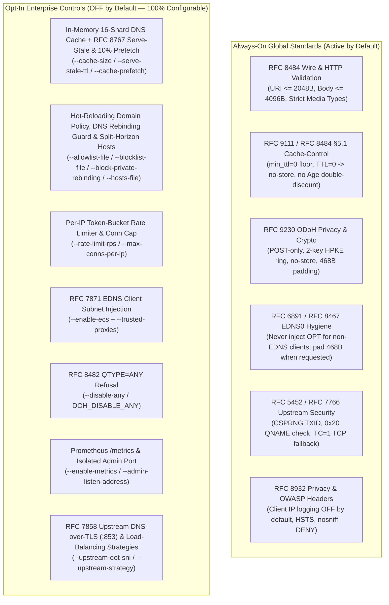

# Global Standards, IETF RFC Compliance & Security Hardening (`daviante-doh`)

<div align="center">

**[Project Home](../README.md)** • **[Architecture & UML](ARCHITECTURE.md)** • **[Global Standards & Security](STANDARDS_AND_SECURITY.md)** • **[Usage Guide & Examples](USAGE_GUIDE.md)** • **[OpenAPI 3.1 Spec](openapi.yaml)** • **[Deployment Guide](DEPLOYMENT.md)** • **[Helm Chart](../charts/daviante-doh/README.md)**

</div>

---

## Table of Contents

1. [Global Standards Enforcement Policy](#1-global-standards-enforcement-policy)
2. [Master RFC & Standards Compliance Matrix](#2-master-rfc--standards-compliance-matrix)
3. [IETF RFC 8484 — DNS Queries over HTTPS (DoH)](#3-ietf-rfc-8484--dns-queries-over-https-doh)
4. [IETF RFC 9111 & RFC 5861 — HTTP Caching & Stale Directives](#4-ietf-rfc-9111--rfc-5861--http-caching--stale-directives)
5. [IETF RFC 9230 — Oblivious DNS over HTTPS (ODoH)](#5-ietf-rfc-9230--oblivious-dns-over-https-odoh)
6. [IETF RFC 6891, RFC 7830 & RFC 8467 — EDNS0 Hygiene & 468-Byte Padding](#6-ietf-rfc-6891-rfc-7830--rfc-8467--edns0-hygiene--468-byte-padding)
7. [IETF RFC 7871 — EDNS Client Subnet (ECS) & Trusted Proxy Verification](#7-ietf-rfc-7871--edns-client-subnet-ecs--trusted-proxy-verification)
8. [IETF RFC 8914 & RFC 8482 — Extended DNS Errors (EDE) & `ANY` Minimization](#8-ietf-rfc-8914--rfc-8482--extended-dns-errors-ede--any-minimization)
9. [IETF RFC 5452 & RFC 7766 — Upstream Forgery Resilience & DNS-over-TCP](#9-ietf-rfc-5452--rfc-7766--upstream-forgery-resilience--dns-over-tcp)
10. [IETF RFC 8932 — DNS Privacy Considerations & Audit Logging](#10-ietf-rfc-8932--dns-privacy-considerations--audit-logging)
11. [OWASP HTTP Security, TLS Hardening & Container/Cluster Security](#11-owasp-http-security-tls-hardening--containercluster-security)

---

## 1. Global Standards Enforcement Policy

`daviante-doh` separates **protocol correctness & security invariants** from **stateful operational policies**:



---

## 2. Master RFC & Standards Compliance Matrix

| Standard / Specification | Title / Scope | Enforcement Status | Implementation Module |
| :--- | :--- | :---: | :--- |
| **IETF RFC 1035** | Domain Names — Implementation and Specification | **Mandatory (Always ON)** | [`src/dns/wire.rs`](../src/dns/wire.rs) |
| **IETF RFC 3597** | Handling of Unknown DNS Resource Record (RR) Types (`TYPE#` / `\\#`) | **Mandatory (Always ON)** | [`src/dns/json.rs`](../src/dns/json.rs) |
| **IETF RFC 5452** | Measures for Making DNS More Resilient against Forged Answers | **Mandatory (Always ON)** | [`src/upstream/mod.rs`](../src/upstream/mod.rs) |
| **IETF RFC 5861** | HTTP `Cache-Control` Extensions for Stale Content (`swr` / `sie`) | **Configurable (`0` default)** | [`src/http/handler.rs`](../src/http/handler.rs) |
| **IETF RFC 6891** | Extension Mechanisms for DNS (`EDNS(0)`) | **Mandatory (Always ON)** | [`src/dns/wire.rs`](../src/dns/wire.rs) |
| **IETF RFC 7239** | `Forwarded` HTTP Extension (`for=` header parsing) | **Mandatory (with `--trusted-proxies`)** | [`src/dns/ecs.rs`](../src/dns/ecs.rs) |
| **IETF RFC 7766** | DNS Transport over TCP — Implementation Requirements (§6.2.1 Pool) | **Mandatory (Always ON)** | [`src/upstream/mod.rs`](../src/upstream/mod.rs) |
| **IETF RFC 7830** | The EDNS(0) Padding Option (Option Code `12`) | **Mandatory (Always ON)** | [`src/dns/wire.rs`](../src/dns/wire.rs) |
| **IETF RFC 7858** | Specification for DNS over Transport Layer Security (`DoT` `:853`) | **Configurable (`--upstream-dot-sni`)** | [`src/upstream/mod.rs`](../src/upstream/mod.rs), [`src/tls.rs`](../src/tls.rs) |
| **IETF RFC 7871** | Client Subnet in DNS Queries (`ECS`, Option Code `8`) | **Configurable (`--enable-ecs`)** | [`src/dns/ecs.rs`](../src/dns/ecs.rs) |
| **IETF RFC 8446 §8** | TLS 1.3 Anti-Replay (`max_early_data_size = 0`, 0-RTT Disabled) | **Mandatory (Always ON)** | [`src/tls.rs`](../src/tls.rs) |
| **IETF RFC 8467** | Padding Policies for Extension Mechanisms for DNS (`468`-Byte Block) | **Mandatory (Always ON)** | [`src/dns/wire.rs`](../src/dns/wire.rs) |
| **IETF RFC 8482** | Providing Minimal-Sized Responses to DNS Queries That Have `QTYPE=ANY` | **Configurable (`--disable-any`)** | [`src/http/handler.rs`](../src/http/handler.rs) |
| **IETF RFC 8484** | DNS Queries over HTTPS (DoH) | **Mandatory (Always ON)** | [`src/http/handler.rs`](../src/http/handler.rs) |
| **IETF RFC 8767** | Serving Stale Data to Improve DNS Resiliency (`EDE 3 Stale Answer`) | **Configurable (`--serve-stale-ttl`)** | [`src/cache.rs`](../src/cache.rs), [`src/http/handler.rs`](../src/http/handler.rs) |
| **IETF RFC 8914** | Extended DNS Errors (`EDE`, Option Code `15`) | **Mandatory (Always ON)** | [`src/dns/wire.rs`](../src/dns/wire.rs) |
| **IETF RFC 8932** | Recommendations for DNS Privacy Service Operators | **Mandatory (Always ON)** | [`src/lib.rs`](../src/lib.rs), [`src/cli.rs`](../src/cli.rs) |
| **IETF RFC 9110 / 9111** | HTTP Semantics & HTTP Caching | **Mandatory (Always ON)** | [`src/http/handler.rs`](../src/http/handler.rs) |
| **IETF RFC 9230** | Oblivious DNS over HTTPS (`ODoH` + HPKE) | **Mandatory (Always ON)** | [`src/dns/odoh.rs`](../src/dns/odoh.rs) |
| **W3C Fetch CORS** | Cross-Origin Resource Sharing (`OPTIONS` preflight & headers) | **Mandatory (Always ON)** | [`src/http/mod.rs`](../src/http/mod.rs) |
| **OWASP REST Security** | Secure Response Headers (`nosniff`, `DENY`, `no-referrer`, `HSTS`) | **Mandatory (Always ON)** | [`src/http/mod.rs`](../src/http/mod.rs) |
| **OpenShift `restricted-v2`** | Arbitrary non-root UID + GID `0`, `readOnlyRootFilesystem`, `cap-drop=ALL` | **Mandatory (Always ON)** | [`Dockerfile`](../Dockerfile), [`charts/daviante-doh/`](../charts/daviante-doh/Chart.yaml) |

---

## 3. IETF RFC 8484 — DNS Queries over HTTPS (DoH)

| Rule ID | Standard Requirement | How `daviante-doh` Enforces It |
| :--- | :--- | :--- |
| **RFC 8484 §4.1** | Support both `GET` (`?dns=<base64url-unpadded>`) and `POST` (`Content-Type: application/dns-message`). | Rejects padded (`=`) or non-URL-safe (`+`, `/`) base64 strings on `GET` with `400 Bad Request`. Validates `Content-Type` on `POST` (`415 Unsupported Media Type` if missing or invalid). |
| **RFC 8484 §4.1.1** | Enforce URI length limits on `GET` / `HEAD`. | Requests with URI length `> 2048` octets are immediately rejected with `414 URI Too Long` before query parsing. |
| **RFC 8484 §6** | Enforce maximum DNS message size (`4096` bytes). | `POST` bodies or decoded `?dns=` payloads exceeding `4096` bytes (`MAX_DNS_QUERY_LEN`) are rejected with `413 Payload Too Large` (or `400` on empty/truncated `< 17B` queries). |
| **RFC 8484 §4.1** | Strict `Accept` content negotiation. | `GET` and `POST` requests with an explicit unsupported `Accept` header (e.g., `text/html`, `image/png`) are rejected with `406 Not Acceptable`. Wildcards (`*/*`, `application/*`) default to `application/dns-message`. |
| **RFC 1035 / 8484** | Strict DNS wire header & question validation. | Rejects packets where `QR != 0` (response sent as query), `OPCODE != 0`, `QDCOUNT != 1`, `ANCOUNT != 0`, `NSCOUNT != 0`, or where compression pointers loop (`0xC0 0x0C`) or point out-of-bounds. Disallows zone-transfer meta-queries (`QTYPE=AXFR 252`, `IXFR 251`). |

---

## 4. IETF RFC 9111 & RFC 5861 — HTTP Caching & Stale Directives

1. **Zero TTL Floor by Default (`min_ttl = 0`)**:
   - Per **RFC 8484 §5.1**, HTTP `Cache-Control: max-age` never artificially inflates an upstream RR's TTL unless the operator explicitly configures `--min-ttl`.
2. **Strict `TTL == 0` Non-Cacheability**:
   - When the minimum Answer RR TTL is `0` (or when an error response has `err_ttl == 0`), `daviante-doh` emits:
     ```http
     Cache-Control: max-age=0, no-cache, no-store
     ```
     and never inserts the response into the in-memory `DnsCache`.
3. **No `Age` Double-Discounting on Cache Hits**:
   - When serving a hit from the in-memory `DnsCache` (`src/cache.rs`), the wire RR TTLs are decremented by `elapsed_secs`, `Cache-Control: public, max-age=<remaining_ttl>, s-maxage=<remaining_ttl>` is set to the **remaining** TTL, and `Age: <elapsed_secs>` is emitted for observability.
4. **Header-Dependent Error Responses**:
   - All `405 Method Not Allowed`, `406 Not Acceptable`, and `415 Unsupported Media Type` responses emit `Cache-Control: no-store` and `Vary: Accept, Content-Type` so shared CDN caches never poison valid requests.

---

## 5. IETF RFC 9230 — Oblivious DNS over HTTPS (ODoH)

- **Cryptographic Suite**: HPKE (`KEM: X25519HkdfSha256`, `KDF: HkdfSha256`, `AEAD: Aes128Gcm`).
- **`POST`-Only Enforcement (RFC 9230 §4.1)**: `GET` or `HEAD` requests carrying `Accept: application/oblivious-dns-message` or `Content-Type: application/oblivious-dns-message` are rejected with `405 Method Not Allowed` (`Allow: POST`, `Cache-Control: no-store`).
- **468-Byte Plaintext Response Padding (RFC 9230 §4.3)**: Before HPKE encryption, every ODoH plaintext response is padded so the encrypted ciphertext resists traffic-analysis size fingerprinting.
- **2-Key Rotation Grace Ring**: `OdohKeyManager` maintains `[current, previous]` keys in an `ArcSwap<OdohKeyRing>`, advertising `current` at `GET /.well-known/odohconfigs` with `Cache-Control: public, max-age=<odoh_rotation_secs / 2>` so no client experiences decryption failures during key rotation.

---

## 6. IETF RFC 6891, RFC 7830 & RFC 8467 — EDNS0 Hygiene & 468-Byte Padding

- **Non-EDNS Client Hygiene (RFC 6891 §6.1.1)**: If a client sends a DNS query **without** an `OPT` record (`ARCOUNT == 0`), `daviante-doh` strips any upstream `OPT` record before returning the wire response so legacy stub resolvers never fail with `FORMERR`.
- **468-Byte Block Padding (RFC 8467 §4.1)**: When a client includes an EDNS0 `OPT` record with the Padding option (`Option Code 12`) or `DO=1`, `daviante-doh` pads the final DNS wire response with `Option Code 12` (`0x00` octets) so the total DNS wire length is an exact multiple of **468 octets**.

---

## 7. IETF RFC 7871 — EDNS Client Subnet (ECS) & Trusted Proxy Verification

> [!WARNING]
> **Untrusted Proxy Header Spoofing Protection**: `daviante-doh` ignores `X-Forwarded-For` and `Forwarded` headers unless the direct TCP peer IP matches a CIDR explicitly listed in `--trusted-proxies` (`DOH_TRUSTED_PROXIES`).

1. **Right-to-Left Hop Evaluation**: When the TCP peer is trusted, `extract_client_ip` walks `X-Forwarded-For` / `Forwarded` **right-to-left**, stripping trusted proxy hops and stopping at the first untrusted external client IP.
2. **Private Address Non-Leakage (RFC 7871 §7.1.2)**: Loopback (`127.0.0.0/8`, `::1`), RFC 1918 private (`10/8`, `172.16/12`, `192.168/16`), link-local (`169.254/16`, `fe80::/10`), ULA (`fc00::/7`), CGNAT (`100.64/10`), and documentation IPs are **never** forwarded in an outbound ECS option.
3. **Prefix Truncation**: Outbound ECS masks IPv4 to `/24` (`--ecs-prefix-v4`) and IPv6 to `/56` (`--ecs-prefix-v6`) by default, and responses carrying non-zero ECS scope emit `Cache-Control: private, no-store`.

---

## 8. IETF RFC 8914 & RFC 8482 — Extended DNS Errors (EDE) & `ANY` Minimization

`daviante-doh` attaches structured **RFC 8914 Extended DNS Error (`Option Code 15`)** options to both binary wire responses (`EDNS0 OPT`) and JSON DoH responses (`"EDE": [{"info_code": ..., "extra_text": "..."}]`):

| EDE Info Code | Constant Name | Trigger Condition | DNS RCODE Returned |
| :---: | :--- | :--- | :--- |
| **`3`** | `Stale Answer` | Expired cached response served during upstream outage per **RFC 8767** (`--serve-stale-ttl > 0`, wire `TTL=30`) | `NOERROR (0)` |
| **`15`** | `Blocked` | Domain or CNAME target blocked by policy with `--block-action nxdomain` | `NXDOMAIN (3)` |
| **`17`** | `Filtered` | Domain/CNAME blocked with `--block-action zero-ip` OR public domain resolving to private/loopback IP when `--block-private-rebinding` is enabled | `NOERROR (0)` / `REFUSED (5)` |
| **`18`** | `Prohibited` | Domain or CNAME target blocked by policy with `--block-action refused` | `REFUSED (5)` |
| **`21`** | `Not Supported` | `QTYPE=ANY (255)` query refused when `--disable-any` (`DOH_DISABLE_ANY=true`) is enabled per **RFC 8482** | `NOTIMP (4)` |
| **`22`** | `No Reachable Authority` | All configured upstream resolvers timed out | `SERVFAIL (2)` |
| **`23`** | `Network Error` | Upstream UDP/TCP/DoT socket I/O error across all configured upstreams | `SERVFAIL (2)` |

---

## 9. IETF RFC 5452, RFC 7766 & RFC 7858 — Upstream Forgery Resilience, DNS-over-TCP & DNS-over-TLS

- **CSPRNG Transaction ID Randomization (RFC 5452 §9.1)**: Every outbound UDP/TCP/DoT query rewrites the 16-bit DNS `TXID` using a thread-local cryptographically secure random number generator (`rand::rng()`), then restores the client's original `TXID` after verification.
- **Spoofed Datagram Rejection Loop**: The UDP receive loop verifies that `packet.len() >= 12`, `TXID == expected_txid`, `QR == 1`, and the response Question section matches the query Question section (case-insensitive). Mismatched datagrams are logged and discarded without terminating the query window.
- **`0x20` Mixed-Case Preservation**: The client's original Question casing (e.g., `eXaMpLe.CoM`) is preserved in the final response.
- **Persistent TCP Connection Pool (RFC 7766 §6.2.1)**: When a UDP response sets `TC=1` (Truncated), `daviante-doh` retries over a pooled TCP `:53` connection (up to `8` idle connections per upstream endpoint, `65,535`-byte buffer).
- **Encrypted Upstream DNS-over-TLS (RFC 7858 `:853`)**: When `--upstream-dot-sni <HOSTNAME>` (`DOH_UPSTREAM_DOT_SNI`) is set, upstream queries are encrypted over TLS 1.2/1.3 using `tokio-rustls` + Mozilla WebPKI root certificates (`webpki-roots`) with persistent connection pooling (`MAX_POOLED_DOT_CONNS_PER_UPSTREAM = 8`) and automatic stale-socket reconnect.
- **Multi-Strategy Load Balancing & Singleflight Coalescing**: Supports `failover` (sequential priority with 30s circuit breaker), `round-robin`, and `parallel` (fastest-wins `JoinSet` race across healthy upstreams), while deduplicating concurrent identical cache-miss queries via Singleflight coalescing (`daviante_doh_coalesced_queries_total`).

---

## 10. IETF RFC 8932 — DNS Privacy Considerations & Audit Logging

Per **RFC 8932 §5.1**, `daviante-doh` defaults to **zero PII retention**:
- `--log-queries` (`DOH_LOG_QUERIES`) defaults to `false`.
- `--log-client-ip` (`DOH_LOG_CLIENT_IP`) defaults to `false` (`ClientIpLogMode::None`).
- When query auditing is enabled by an enterprise operator, `--log-client-ip` supports three explicit modes:
  1. `none` (`false` / `0`): Never log client IP (`"client_ip":"None"`).
  2. `truncated`: Anonymize IPv4 to `/24` (e.g., `203.0.113.0`) and IPv6 to `/56` before logging.
  3. `full`: Log the client IP for internal security auditing.

---

## 11. OWASP HTTP Security, TLS Hardening & Container/Cluster Security

### 11.1 OWASP HTTP Security Headers (Always Injected)
Every HTTP response from `daviante-doh` includes:
- `X-Content-Type-Options: nosniff`
- `X-Frame-Options: DENY`
- `Referrer-Policy: no-referrer`
- `Cross-Origin-Resource-Policy: cross-origin`
- `Strict-Transport-Security: max-age=63072000; includeSubDomains` (when TLS is enabled)

### 11.2 TLS 1.2 / 1.3 Cryptographic Hardening (`src/tls.rs`)
- Powered by `tokio-rustls` + `ring` (zero OpenSSL C dependencies).
- **TLS 1.3 Early Data (`0-RTT`) is unconditionally disabled** (`max_early_data_size = 0`) per **RFC 8446 §8** to prevent DNS query replay attacks.
- Configurable minimum protocol version (`--tls-min-version 1.2` or `--tls-min-version 1.3`).
- Automatic 60-second background certificate and private-key hot-reloading (`ReloadableTlsAcceptor`).

### 11.3 Container, Kubernetes & Red Hat OpenShift Hardening
- **Rootless Execution**: Runs as UID `10001`, GID `0` (`USER 10001:0`) with `/etc/daviante-doh` permissions set to `g=u` (`0775`/`0664`), satisfying both standard Kubernetes (`runAsNonRoot: true`) and **Red Hat OpenShift `restricted-v2` SCC** (which injects an arbitrary namespace-scoped UID with GID `0`).
- **Read-Only Root Filesystem**: Compatible with `readOnlyRootFilesystem: true`, `allowPrivilegeEscalation: false`, `capabilities.drop: [ALL]`, and `seccompProfile.type: RuntimeDefault`.
- **Zero Shell/Curl Runtime Attack Surface**: Health probes execute `/usr/local/bin/daviante-doh --healthcheck` directly without requiring `curl` or `wget` inside the container.
